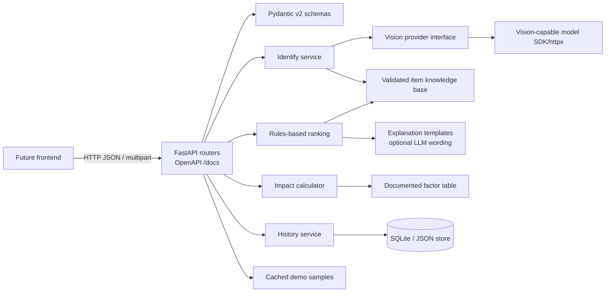

# WasteVisor Backend Architecture

## Target boundary

New backend work lives under `backend/` and uses Python 3.11+, FastAPI, Uvicorn, and Pydantic v2. Existing root Node/React files are inspected legacy context and remain untouched. The frontend will be a separate future client of the HTTP API.

## Component view



## Request flow

1. `/api/identify` validates an uploaded image and asks the provider interface for strict identification JSON.
2. Pydantic validates item, material, category, condition, hazard flags, confidence, and confirmation status. Retry invalid model output once; otherwise return a safe unknown/confirmation result without crashing.
3. `/api/recommend` accepts a confirmed item and condition plus optional city/context. The deterministic rules engine chooses eligible actions from the validated knowledge base and ranks them for that item's condition. Language-model output may only phrase explanations for already-ranked actions; templates are the fallback.
4. Impact and value estimates are calculated from documented factors, each annotated as an estimate.
5. `/api/actions/complete` persists the chosen action. `/api/history` and `/api/impact` read persisted events and derived totals.
6. With `DEMO_MODE=true`, identify requests for supported hero samples use cached responses. `/api/demo/samples` exposes sample identifiers and labels. With demo mode off, identification uses the live provider.

## Proposed folder structure

```text
backend/
  app/
    main.py                 # FastAPI app, lifespan, CORS, router registration
    api/                     # identify, recommend, actions, history, impact, items, health, demo
    schemas/                 # Pydantic v2 request and response contracts
    services/                # vision, ranking, explain, impact, history
    core/                    # settings, logging, error handling
    data/                    # validated knowledge_base.yaml, impact_factors.yaml
  samples/                   # demo images and cached identification JSON
  tests/                     # pytest unit and API tests
  scripts/demo_flow.py
  requirements.txt
  .env.example
  README.md
```

## API surface

The designed contract is documented in [api.md](api.md). It includes `POST /api/identify`, `POST /api/recommend`, `POST /api/actions/complete`, `GET /api/history`, `GET /api/impact`, `GET /api/items`, `GET /api/health`, and `GET /api/demo/samples`. All errors use the same JSON envelope; FastAPI-generated `/docs` must match these typed schemas.

## Storage and configuration

Use SQLite for completed actions if it fits the schedule; local JSON is the documented fallback. No auth, microservices, MongoDB, or heavy infrastructure. Read secrets and feature flags from environment configuration and ship only `.env.example`. Enable localhost CORS for a future frontend.

## Trust and safety constraints

- Knowledge-base rules, not the language model, define eligible action types and order.
- Hazard rules override reuse/recycling; used batteries route to hazardous collection guidance.
- Unknown items request confirmation and receive conservative general guidance.
- Do not imply local service availability without verified location data.
- Never return an unqualified impact/value number; include assumptions/source and `is_estimate: true`.
